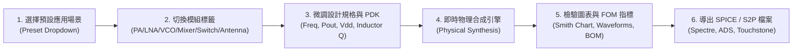

# AutoRF 射頻前端積體電路設計平台使用指南 (User Manual)
### Universal CMOS RF & Millimeter-Wave Front-End Transceiver Synthesis Manual

歡迎使用 **AutoRF 射頻前端積體電路設計與合成系統 (AutoRF RF Front-End Design & Synthesis Guide)**。本手冊旨在為射頻與毫米波積體電路（RFIC / MMIC）設計工程師、通訊系統架構師、半導體研發人員及高校微電子領域師生提供詳盡的系統操作指引、物理理論依據、電路拓樸合成邏輯及 EDA 模擬工具串接教學。

---

## 目錄 (Table of Contents)

1. [系統概觀與軟體架構 (System Overview & Architecture)](#1-系統概觀與軟體架構)
2. [介面導覽與操作工作流程 (User Interface & Workflow)](#2-介面導覽與操作工作流程)
3. [六大收發機模組設計理論與合成 (Six Front-End Building Blocks)](#3-六大收發機模組設計理論與合成)
   - [3.1 功率放大器 (PA - Power Amplifier)](#31-功率放大器-pa---power-amplifier)
   - [3.2 低雜訊放大器 (LNA - Low-Noise Amplifier)](#32-低雜訊放大器-lna---low-noise-amplifier)
   - [3.3 壓控振盪器 (VCO - Voltage-Controlled Oscillator)](#33-壓控振盪器-vco---voltage-controlled-oscillator)
   - [3.4 下混頻器 (Mixer - Down-Conversion Mixer)](#34-下混頻器-mixer---down-conversion-mixer)
   - [3.5 收發雙工開關 (T/R Switch)](#35-收發雙工開關-tr-switch)
   - [3.6 封裝天線 (AiP Antenna-in-Package)](#36-封裝天線-aip-antenna-in-package)
4. [八大核心視覺化圖表與高階分析解讀 (Interactive Visualizations & Analysis Guide)](#4-八大核心視覺化圖表與高階分析解讀-interactive-visualizations--analysis-guide)
   - [4.1 史密斯圓圖與等高線 (Smith Chart & Contours)](#41-史密斯圓圖與等高線-smith-chart--contours)
   - [4.2 暫態波形與動態負載線 (Waveforms & Dynamic Load-Line)](#42-暫態波形與動態負載線-waveforms--dynamic-load-line)
   - [4.3 晶片電路圖與元件清單 (Schematic & BOM)](#43-晶片電路圖與元件清單-schematic--bom)
   - [4.4 全收發鏈路預算與相控陣列波束賦形 (Link Budget & Phased Array Beamforming)](#44-全收發鏈路預算與相控陣列波束賦形-link-budget--phased-array-beamforming)
   - [4.5 互動式阻抗匹配網路合成器 (Impedance Matching Synthesizer)](#45-互動式阻抗匹配網路合成器-impedance-matching-synthesizer)
   - [4.6 晶片面積估算與平面佈局 (Die Area Breakdown & Floorplan)](#46-晶片面積估算與平面佈局-die-area-breakdown--floorplan)
   - [4.7 製程角 PVT 容差與敏感度分析 (PVT Corners Analysis)](#47-製程角-pvt-容差與敏感度分析-pvt-corners-analysis)
   - [4.8 模擬網表與一鍵工程規格書導出 (SPICE Decks, S2P & Full Spec Report)](#48-模擬網表與一鍵工程規格書導出-spice-decks-s2p--full-spec-report)
5. [EDA 軟體整合教學 (EDA Tool Integration Guide)](#5-eda-軟體整合教學)
   - [5.1 Keysight ADS (先進設計系統) 整合](#51-keysight-ads-先進設計系統-整合)
   - [5.2 Cadence Virtuoso / Spectre 整合](#52-cadence-virtuoso--spectre-整合)
   - [5.3 LTspice 與 ngspice 獨立模擬](#53-ltspice-與-ngspice-獨立模擬)
6. [常見問題與除錯指南 (FAQ & Troubleshooting)](#6-常見問題與除錯指南-faq--troubleshooting)

---

## 1. 系統概觀與軟體架構

### 1.1 設計哲學
在傳統射頻前端設計中，工程師往往需要在電晶體尺寸估算、偏置點選取、共軛匹配網路計算及電磁模擬之間來回迭代數週。AutoRF 建立在**第一性半導體物理定律（First-Principles Physics）**與**高頻晶體管比例微縮法則（Scaling Laws）**之上，具備以下核心能力：
1. **秒級即時物理閉環合成**：輸入頻率與功率/增益等關鍵規格，系統自動推算電晶體幾何微米尺寸（寬度 $W$、長度 $L$、閘極指狀數 $NF$）、負載阻抗與偏置電壓。
2. **六大收發模組全鏈路覆蓋**：PA、LNA、VCO、Mixer、Switch、Antenna，構成完整毫米波單晶收發前端。
3. **PDK 半導體製程深度映射**：包含 TSMC 28nm HPC+、40nm RF LP、65nm RF CMOS 與 0.18µm RF CMOS，考量寄生電容（$C_{gs}, C_{gd}, C_{ds}$）、基極電阻、膝電壓（$V_{knee}$）與崩潰電壓界限。
4. **雙端支援**：提供純前端零依賴 Web 應用程式（即開即用）與 Python 命令列 / API 程式化設計介面。

---

## 2. 介面導覽與操作工作流程

### 步驟說明：
1. **選擇預設應用 (Presets)**：
   - 頂部導覽列提供 9 組典型場景：
     - `2.4 GHz Wi-Fi / BLE (65nm)`
     - `5.2 GHz Wi-Fi 6E / Sub-6G (40nm)`
     - `28 GHz 5G FR2 mmWave (28nm)`
     - `39 GHz 5G 高頻段與衛星通訊 (28nm)`
     - `60 GHz WiGig / 無線高畫質傳輸 (28nm)`
     - `73 GHz 5G/6G E-Band 骨幹回傳 (28nm)`
     - `77 GHz 車用 FMCW 雷達 (72-79 GHz, 28nm)`
     - `77 GHz 工業微米級物位感測與成像 (28nm)`
     - `Sub-1 GHz IoT 長距離物聯網 (180nm)`
   - 選擇預設後，工作頻率、目標指標、PDK 節點與偏置電壓將自動初始化至業界推薦最佳值。
2. **切換設計模組 (Module Switcher)**：
   - 點擊頂部的 `PA`、`LNA`、`VCO`、`Mixer`、`Switch` 或 `Antenna` 按鈕，左側控制面板會即時切換出該模組特有的可調參數。
3. **規格微調與即時反饋**：
   - 調整中心頻率、目標輸出功率、增益、供電電壓或片上電感品質因子 $Q$。所有頂部 FOM 數值、圖表及網表會在 10 毫秒內同步更新完畢。
4. **功能輔助按鈕**：
   - 🌐 **中文 / EN**：一鍵切換全介面繁體中文與專業英文術語。
   - 🌙 / ☀️ **主題切換**：切換高對比深色工程模式與明亮辦公模式。
   - 📖 **術語字典 (Glossary)**：展開全模組核心公式與物理定義查詢抽屜。
   - 📘 **使用手冊 (Manual)**：展開本操作指南之互動式檢閱視窗。

---

## 3. 六大收發機模組設計理論與合成

### 3.1 功率放大器 (PA - Power Amplifier)
- **核心演算法：Cripps 大訊號負載線合成**
  $$R_{opt} = \frac{2(V_{DD} - V_{knee})^2}{P_{out}}$$
  在給定供電電壓 $V_{DD}$ 與電晶體飽和膝點電壓 $V_{knee}$ 條件下，計算出汲極端能抽取最大不失真射頻功率之最佳實部阻抗。
- **電晶體尺寸微縮**：
  $$W_{tot} = \frac{I_{max}}{J_{max}} = \frac{2 \cdot I_{dc,peak}}{J_{max}}$$
  根據 PDK 飽和電流密度極限 $J_{max}$（例如 28nm HPC+ 為 $1.10\text{ mA}/\mu\text{m}$）決定總閘極寬度，並自動配置指狀結構以抑制閘極多晶矽分佈電阻。
- **差動交叉中和技術 (Cross-Coupled Neutralization)**：
  在差動疊接（Differential Cascode）架構中，引入交叉電容 $C_{neu} \approx C_{gd}$，將相反相位的交流訊號注入閘極，消除 Miller 寄生效應，保證毫米波全頻段 Rollett 穩定因子 $K > 1$。
- **片上整合變壓器 Balun**：
  自動計算磁耦合係數 $k$（典型為 $0.72 \sim 0.85$）、初次級線圈電感值及匝數比 $n = \sqrt{R_{L} / (2 R_{opt})}$，直接將差動汲極輸出轉換至標準 $50\,\Omega$ 單端天線端。

### 3.2 低雜訊放大器 (LNA - Low-Noise Amplifier)
- **電感源極退化技術 (Inductive Source Degeneration)**：
  $$Z_{in} = s(L_g + L_s) + \frac{1}{s C_{gs}} + \left(\frac{g_m}{C_{gs}}\right) L_s$$
  在共振頻率 $\omega_0 = 1/\sqrt{(L_g + L_s) C_{gs}}$ 處，虛部相互抵消，輸入阻抗呈現純實數：
  $$R_{in} = \omega_T \cdot L_s \approx 50\,\Omega$$
  此實數電阻由受控源跨導產生，**不引入任何額外導體熱雜訊**。
- **同步雜訊與輸入匹配 (SNIM)**：
  透過最佳尺寸調諧，使最小雜訊反射係數 $\Gamma_{opt}$ 與共軛輸入阻抗匹配點 $\Gamma_{in}^*$ 在史密斯圖上重合，實現極致雜訊指數 ($NF \le 1.8\sim 2.3\text{ dB}$) 與高輸入回波損耗 ($S_{11} < -15\text{ dB}$)。

### 3.3 壓控振盪器 (VCO - Voltage-Controlled Oscillator)
- **互補交叉耦合負電導 (-Gm Core)**：
  由 NMOS 與 PMOS 交叉耦合管構成負阻單元，提供 $-G_m = -\frac{1}{2}(g_{mn} + g_{mp})$。
- **起振裕度保證 (Barkhausen Startup Condition)**：
  $$G_m \ge \alpha_{startup} \cdot G_{tank} = \alpha_{startup} \cdot \frac{1}{R_p}$$
  系統自動設定起振裕度因子 $\alpha_{startup} \ge 2.5 \sim 3.0$，確保在任何低溫、高溫及製程變異（PVT Corners）下均能可靠起振。
- **Leeson 相位雜訊模型**：
  $$\mathcal{L}(\Delta\omega) = 10 \log_{10} \left[ \frac{2 k_B T F}{P_{sig}} \left( 1 + \left( \frac{\omega_0}{2 Q \Delta\omega} \right)^2 \right) \left( 1 + \frac{\Delta\omega_{1/f^3}}{|\Delta\omega|} \right) \right]$$
  綜合 LC 諧振腔 $Q$ 值、載波訊號功率 $P_{sig}$ 與 $1/f$ 閃爍雜訊轉角，精確預測 1 MHz 頻偏處的相位雜訊。

### 3.4 下混頻器 (Mixer - Down-Conversion Mixer)
- **雙平衡吉爾伯特乘法單元 (Double-Balanced Gilbert Cell)**：
  下層為差動射頻跨導輸入級（$g_{m,RF}$），中層為 4 顆由本振 LO 驅動的快速切換開關，上層為差動負載電阻與濾波電容。
- **性能特點**：
  - 轉換增益：$G_c \approx \frac{2}{\pi} g_{m,RF} R_L$
  - 天然具備優異的 LO-to-RF 及 LO-to-IF 差動對稱隔離度（$> 35\text{ dB}$），避免本振洩漏造成接收前端飽和。

### 3.5 收發雙工開關 (T/R Switch)
- **拓樸結構：SPDT 串並聯結構 (Series-Shunt)**：
  - 導通支路：串聯 FET 導通（小電阻 $R_{on}$），並聯 FET 截止。
  - 隔離支路：串聯 FET 截止（小電容 $C_{off}$），並聯 FET 導通將洩漏訊號接地。
- **性能指標折衝**：
  $$IL \approx 10 \log_{10} \left( 1 + \frac{R_{on}}{Z_0} \right),\quad ISO \approx 20 \log_{10} (\omega C_{off} Z_0 / 2)$$
  利用多重 FET 堆疊（Multi-Stacking）與基極高阻浮接（Body-Floating Resistors），實現高達 $+24\text{ dBm}$ 的功率承受能力 ($P_{1dB}$)。

### 3.6 封裝天線 (AiP Antenna-in-Package)
- **矩形微帶貼片天線 (Inset-Fed Microstrip Patch)**：
  - 輻射貼片寬度：$W = \frac{c}{2 f_0} \sqrt{\frac{2}{\varepsilon_r + 1}}$
  - 諧振長度：$L = \frac{c}{2 f_0 \sqrt{\varepsilon_{eff}}} - 2\Delta L$（考量邊緣伸展電場效應 $\Delta L$）。
  - 內縮饋電深度 $y_0$：精確匹配至 $50\,\Omega$ 微帶傳輸線，實現天線諧振回波損耗 $S_{11} < -20\text{ dB}$，天線輻射增益可達 $5.0 \sim 7.5\text{ dBi}$。

---

## 4. 八大核心視覺化圖表與高階分析解讀 (Interactive Visualizations & Analysis Guide)

### 4.1 史密斯圓圖與等高線 (Smith Chart & Contours)
- **PA 負載牽引等功率線**：圓圖中心為 $50\,\Omega$ 標準系統阻抗。藍色亮點標示汲極端最佳負載反射係數 $\Gamma_{opt}$。外圍同心橢圓分別代表功率下降 $-0.5\text{ dB}$（紅）、$-1.0\text{ dB}$（黃）、$-2.0\text{ dB}$（綠）之負載容許失配區域。
- **LNA 等雜訊圓 (Noise Circles)**：綠色（$+0.3\text{ dB}$）、黃色（$+0.6\text{ dB}$）、紅色（$+1.0\text{ dB}$）等雜訊指數圓，直觀指導信號源阻抗調諧。
- **VCO / Switch / Antenna 模式**：分別動態展示諧振腔阻抗、開關 ON/OFF 狀態軌跡點及天線中心共振頻點。

### 4.2 暫態波形與動態負載線 (Waveforms & Dynamic Load-Line)
- **時域波形（左圖）**：精確繪製 2 個 RF 週期內的汲極大訊號電壓 $V_{ds}(t)$（藍色）與汲極電流 $I_{ds}(t)$（綠色）。波形底部受限於半導體膝電壓 $V_{knee}$，清晰呈現非線性飽和壓縮行為。
- **動態負載線（右圖）**：展示 $I_{ds}$ 對 $V_{ds}$ 的瞬態相平面軌跡，輔助工程師確認電晶體操作點是否超出半導體安全操作區（SOA, Safe Operating Area）。

### 4.3 晶片電路圖與元件清單 (Schematic & BOM)
- 呈現標準 IEEE 規範之四端 MOSFET 電晶體符號（Gate, Drain, Source, Channel），包含偏置線路、交叉中和電容及片上變壓器。
- 下方附帶完整的物料清單（BOM），詳列所有主動管指狀尺寸與被動元件值（$L, C$）及設計用途。

### 4.4 全收發鏈路預算與相控陣列波束賦形 (Link Budget & Phased Array Beamforming)
- **Friis 級聯雜訊與增益分析**:
  - 即時呈現接收機總轉換增益 $Gain_{rx}$（LNA + 混頻器轉換增益 - 開關插損）。
  - 計算 Friis 級聯雜訊指數 $NF_{rx} = NF_1 + \frac{NF_2 - 1}{G_1} + \frac{NF_3 - 1}{G_1 G_2}$ 與接收靈敏度 $Sensitivity = -174 + 10\log_{10}(BW) + NF_{rx} + SNR_{min}$。
- **相控陣列 2D 波束賦形**:
  - 支援 $1\times 1, 1\times 4, 1\times 8, 4\times 4, 8\times 8$ 陣列規模切換。
  - 支援波束指向角 $\theta \in [-60^\circ, +60^\circ]$ 即時掃描，整合 4/5/6-Bit 移相器步進量化模型。
  - Canvas 即時繪製極坐標陣列因子（Array Factor）天線輻射方向圖、主瓣波束銳化角（HPBW）與相干空間功率疊加 EIRP。

### 4.5 互動式阻抗匹配網路合成器 (Impedance Matching Synthesizer)
- **四種匹配架構即時切換**:
  - `L-型 低通 (Series L + Shunt C)`: 高頻諧波抑制首選。
  - `L-型 高通 (Series C + Shunt L)`: 天然隔直流（DC-Blocking）。
  - `Π-型 寬頻匹配 (Pi-Match)`: 提升選擇性與特定頻寬控制。
  - `T-型 帶通匹配 (T-Match)`: 雙串聯單並聯，適用於高阻變比。
- **物理特性與實部/虛部阻抗轉換**:
  - 支援「🔄 套用目前模組阻抗」一鍵導入 PA $R_{opt}$ 或 LNA $R_{in}$。
  - 納入片上電感有限 $Q$ 值（Inductor $Q$），即時計算有載品質因子 $Q$ 與插入損耗（Insertion Loss, IL）。
  - 於史密斯圖上動態標註 $Z_S \to Z_L$ 的實時路徑軌跡。

### 4.6 晶片面積估算與平面佈局 (Die Area Breakdown & Floorplan)
- **主動/被動/銲墊分佈分解**:
  - 主動電晶體核心區（Transistor Core + Guard Ring）。
  - 片上被動元件區（片上螺旋線圈電感、Balun 變壓器、MIM 電容陣列）。
  - 周邊銲墊環外圍（Pad Ring，含 $80\,\mu\text{m}$ 間距之 32-Pin I/O 銲墊）。
- **單片裸晶量產成本預估**:
  - 基於 12 吋（300mm）晶圓量產模型，自動換算單顆晶粒製造單價。
  - 繪製等比例單晶毫米波收發機單晶片（Monolithic Transceiver）平面規劃圖（Floorplan SVG）。

### 4.7 製程角 PVT 容差與敏感度分析 (PVT Corners Analysis)
- **全製程角工作條件矩陣**:
  - `TT (典型角)`: $25^\circ\text{C}, 1.20\text{V}$。
  - `FF (快快角)`: $-40^\circ\text{C}, 1.32\text{V}$（最劣耐壓與熱載子注入考量）。
  - `SS (慢慢角)`: $+125^\circ\text{C}, 1.08\text{V}$（最劣高溫載子遷移率衰減與增益損失）。
  - `FS` 與 `SF` 混合非對稱角。
- **良率指標檢驗**: 實時驗證 PA 飽和功率/PAE、LNA 增益/NF、VCO 頻偏與起振跨導裕度（Margin $> 2.0\times$）。

### 4.8 模擬網表與一鍵工程規格書導出 (SPICE Decks, S2P & Full Spec Report)
- **一鍵導出完整工程規格書 (📄 Report)**:
  - 點擊「📄 導出工程規格書 (Report)」，立即自動生成並下載專業格式 HTML 規格書，完整封裝：
    1. 系統級級聯鏈路預算總表。
    2. 六大模組核心物理合成數據與元件尺寸表。
    3. 晶片面積與矽片成本預估。
    4. 5大製程角 PVT 容差矩陣。
    5. SPICE / Spectre 模擬網表代碼塊。
- **SPICE / Spectre 網表**: 一鍵複製或下載標準 `.sp` 檔案。
- **Touchstone S2P 檔案**: 下載標準 `.s2p` 2-Port 散射參數檔案。
- **JSON 原始結構化設計檔**: 下載包含所有微米級幾何尺寸的 `.json` 檔案。

---

## 5. EDA 軟體整合教學

### 5.1 Keysight ADS (先進設計系統) 整合
1. **載入 Touchstone S2P 檔案**：
   - 在 AutoRF 點擊「⬇️ 下載 .s2p」。
   - 開啟 ADS 原理圖，在元件庫搜尋並放置 `S2P` 元件（Data Items 面板）。
   - 雙擊 S2P 元件，在 `File` 欄位指向下載之 `.s2p` 檔案。
   - 放置 `Term`（端點 1 與端點 2 設定為 50 Ohm）並執行 `S_Param` 模擬，即可進行系統鏈路 S 參數與級聯預算分析。

### 5.2 Cadence Virtuoso / Spectre 整合
1. **匯入 SPICE 網表**：
   - 點擊「⬇️ 下載 .sp」取得產生的網表文件。
   - 在 Virtuoso ADE L / ADE Explorer 中，進入選單 **Setup -> Model Libraries...**。
   - 點擊瀏覽按鈕將下載之 `.sp` 檔案納入，並設定為 `Include` 模式。
   - 設定直流工作點分析（`.dc`）與高頻大訊號週期穩態分析（PSS / PAC），即可對標本系統之理論值。

### 5.3 LTspice 與 ngspice 獨立模擬
1. 本系統產生的 `.sp` 檔案內含完備的 `.model CMOS_RF_NMOS NMOS LEVEL=3` 緊湊模型與 `.tran` 瞬態語法，無需外加任何商用授權，直接使用 LTspice 或命令列 `ngspice autorf_pa_2.4ghz.sp` 即可一鍵運行瞬態波形分析。

---

## 6. 常見問題與除錯指南 (FAQ & Troubleshooting)

### Q1: 為什麼 Rollett 穩定因子 $K < 1$？這代表什麼？該如何處置？
- **解答**：當 $K < 1$ 時，代表放大器在特定信號源或負載阻抗下可能產生自激振盪（條件穩定）。在毫米波頻段，這主要是由於 MOSFET 汲極至閘極的重疊反饋電容 $C_{gd}$ 造成。
- **解決方案**：
  1. 請確保在拓樸中勾選 **「差動交叉中和電容 (Cneu)」**，系統會配置與 $C_{gd}$ 等值之交叉電容抵消 Miller 反饋，即可使 $K$ 迅速提升至 $> 1.2$（絕對無條件穩定）。
  2. 若為單端電路，可考慮在閘極端串接小阻值（$2 \sim 5\,\Omega$）阻尼電阻或降低工作增益。

### Q2: 毫米波頻段 (如 60 GHz / 77 GHz) 片上電感品質因子 $Q$ 為何通常偏低？
- **解答**：標準矽基 CMOS 的基板電阻率通常較低（約 $10\,\Omega\cdot\text{cm}$），在高頻下電磁場會引發嚴重的基板渦流損耗與金屬層集膚效應。
- **設計指引**：AutoRF 已預設在 28nm 毫米波下選用超厚金屬層（Ultra-Thick Metal, UTM）頂層線圈，系統預設 $Q \approx 18$。若採用封裝載板（AiP）整合電感，其 $Q$ 值可提升至 30 以上。

### Q3: 如何在低功耗物聯網 (IoT) 延長電池壽命？
- **解答**：將工作類別（Operation Class）切換至 **Class-E** 或 **Class-F** 開關型模式。此模式下電晶體工作於零電壓切換（ZVS），理論汲極效率可突破 $75\%$，大幅壓低直流功耗。

---

© 2026 AutoRF Integrated Front-End Design Suite. Open Source under MIT License.
